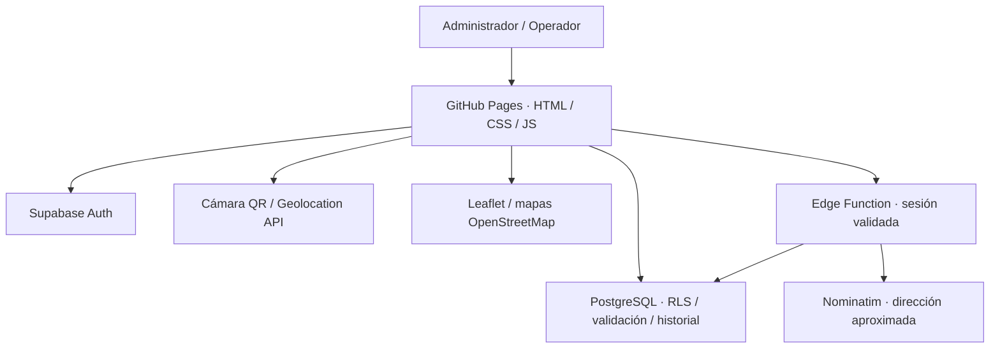
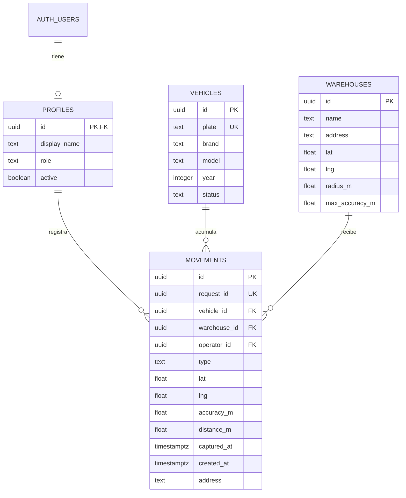
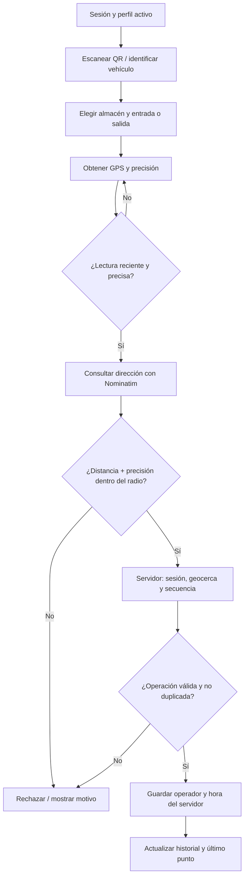

# Arquitectura y modelo · Grupo 03

## Arquitectura

El navegador solo recibe URL y clave publicable. La clave privilegiada solo existe en Edge Functions. Auth identifica al usuario; los roles activos se consultan en perfiles. PostgreSQL verifica las reglas incluso si se omite la interfaz. La función de Nominatim valida usuario, origen y cuota global. Leaflet dibuja almacenes y últimos registros, sin rastreo continuo.

## Entidades y relaciones

`movements` además guarda `warehouse_lat`, `warehouse_lng`, `radius_m`, `max_accuracy_m`, `warehouse_name` y `vehicle_plate`: son la configuración y etiquetas históricas del momento de registro. `request_id` es clave única para idempotencia. Un vehículo tiene muchos movimientos; cada movimiento corresponde a un único almacén y operador. Profiles no se edita desde el cliente.

Tablas internas: `flota_private.geocode_cache` (key PK, address, created_at) y `flota_private.api_gate` (singleton, last_request). No forman parte del catálogo visible al usuario y solo el servidor accede a ellas.

## Secuencia de operación

Si Nominatim falla, se puede conservar un movimiento válido con coordenadas y sin dirección. La falta de cámara permite pegar el contenido de un QR válido como alternativa de accesibilidad; para demostrar RF05 debe usarse la cámara.
